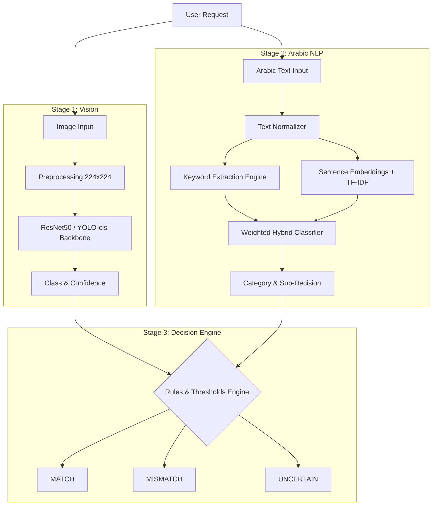

# 🛠️ Multimodal Maintenance Verification System (AI Fraud & Mismatch Prevention)

[](https://www.python.org/downloads/)
[](https://pytorch.org/)
[](LICENSE)
[](#)

A production-grade, multimodal AI pipeline designed to validate and verify maintenance claims in home service platforms and field management applications. The system evaluates whether an uploaded damage/maintenance photo semantically matches the customer's Arabic text description to prevent fraudulent claims, human error, and dispatch confusion.

---

## 📌 Table of Contents

- [Overview & Architecture](#-overview--architecture)
  - [System Flow](#system-flow)
  - [Supported Categories](#supported-categories)
- [Pipeline Components](#-pipeline-components)
  - [Stage 1: Computer Vision (Image Classification)](#stage-1-computer-vision-image-classification)
  - [Stage 2: NLP & Arabic Semantic Classification](#stage-2-nlp--arabic-semantic-classification)
  - [Stage 3: Decision & Arbitration Engine](#stage-3-decision--arbitration-engine)
- [Project Structure](#-project-structure)
- [Installation & Setup](#-installation--setup)
- [Quickstart & Backend Integration](#-quickstart--backend-integration)
  - [1. Full Verification (Image + Text)](#1-full-verification-image--text)
  - [2. Image-Only Classification](#2-image-only-classification)
  - [3. Text-Only Classification](#3-text-only-classification)
  - [4. Health Check Endpoint](#4-health-check-endpoint)
  - [5. FastAPI Server Integration Example](#5-fastapi-server-integration-example)
- [Decision Matrix & Edge Cases](#-decision-matrix--edge-cases)
- [Verification & Testing](#-verification--testing)
- [Performance & Hardware Guidelines](#-performance--hardware-guidelines)
- [License](#-license)

---

## 🔍 Overview & Architecture

When users report home maintenance issues (e.g., plumbing leaks, electrical shorts, carpentry damage, painting jobs), they often attach pictures. This system guards backends by detecting:
1. **Relevance**: Filters out selfies, memes, landscapes, or unrelated photos (`irrelevant`).
2. **Text Semantics**: Identifies repair intent in Egyptian and standard Arabic dialects or flags unrelated/gibberish text.
3. **Multimodal Alignment**: Confirms whether the image and the written text describe the same craft domain.

### System Flow



### Supported Categories

| Arabic Category | English Key | Description | Example Queries |
| :--- | :--- | :--- | :--- |
| **سباكة** | `plumbing` | Water leakage, faucets, drain pipes, flush tanks | "الحنفية بتسرب ميه", "تسريب ماسورة" |
| **كهرباء** | `electricity` | Outlets, short circuits, switchboards, wiring | "الفيشة بتطلع شرار", "اللمبة مش شغالة" |
| **نجارة** | `carpentry` | Broken doors, hinges, wooden frames, furniture | "مفصلة الباب مكسورة", "الدولاب بيزيق" |
| **نقاشة** | `painting` | Wall peeling, plaster cracks, moisture, repaint | "الحيطة مقشرة", "في رطوبة في الدهان" |
| **غير متعلق بالصيانة** | `irrelevant` | Non-maintenance items (cars, faces, food, memes) | "صباح الخير", "صورة عشوائية" |

---

## 🧠 Pipeline Components

### Stage 1: Computer Vision (Image Classification)
- **Model**: `timm/resnet50` (or plug-and-play `YOLO-cls`) trained on real-world home repair and damage imagery.
- **Input**: Supports raw bytes (`bytes`), file paths (`str`, `Path`), or `PIL.Image`.
- **Normalization**: Resized to 224x224, normalized via ImageNet mean/std distribution.
- **Output**: Returns category probabilities, top label, and numeric confidence score.

### Stage 2: NLP & Arabic Semantic Classification
- **Preprocessing & Dialect Normalization**:
  - Unifies Hamza variants (`أ`, `إ`, `آ` $\rightarrow$ `ا`), Ta-Marbuta (`ة` $\rightarrow$ `ه`), and Alef-Maksura (`ى` $\rightarrow$ `ي`).
  - Strips Tashkeel (diacritics), non-alphanumeric noise, and repeated spaces.
- **Feature Extraction**:
  - **Contextual Embeddings**: Multilingual MiniLM (`sentence-transformers`).
  - **Lexical Matching**: Word-level & Char-level TF-IDF sparse matrices.
  - **Rule-Based Domain Lexicon**: Scored keywords with bonuses for compound terms (e.g., "تسريب مياه").
- **Ensemble Bundle**: Scaled concatenation passed to a calibrated classifier bundle (`stage2_text_bundle.joblib`).

### Stage 3: Decision & Arbitration Engine
Combines predictions from Stage 1 and Stage 2 with deterministic safety logic:
- **`MATCH`**: Both models agree on the craft category with high confidence.
- **`MISMATCH`**: Confident cross-domain mismatch (e.g., photo is `electricity` while text is `plumbing`), or either input is flagged as `irrelevant`.
- **`UNCERTAIN`**: Ambiguous keywords, low model confidence ($<0.60$ for image, $<0.55$ for text), or near-boundary classification conflict requiring human review.

---

## 📂 Project Structure

```text
fake_image/
│
├── config.py                  # Thresholds, category mappings, and path configs
├── pipeline.py                # Core production pipeline (MaintenancePipeline)
├── text_utils.py              # Arabic normalization, regex cleaner, keyword detector
├── verify_setup.py            # Self-test validation & diagnostic script
├── requirements.txt           # Production dependencies
├── README.md                  # Comprehensive documentation
│
└── models/
    ├── stage1/
    │   ├── best_model.pt      # Pretrained PyTorch image classifier weights
    │   └── best_model_info.json # Model metadata, framework type, and architecture
    └── stage2/
        └── stage2_text_bundle.joblib # Serialized NLP model bundle, TF-IDF, & lexicons
```

---

## 🚀 Installation & Setup

### Prerequisites
- Python 3.10 or higher
- CUDA-enabled GPU (optional; runs seamlessly on CPU)

### 1. Clone & Create Virtual Environment
```bash
# Clone the repository
git clone https://github.com/your-org/fake_image.git
cd fake_image

# Create virtual environment
python -m venv venv

# Activate virtual environment
# On Linux/macOS:
source venv/bin/activate
# On Windows (PowerShell):
.\venv\Scripts\Activate.ps1
```

### 2. Install Dependencies
```bash
pip install --upgrade pip
pip install -r requirements.txt
```

---

## 💻 Quickstart & Backend Integration

The `MaintenancePipeline` is designed for high-throughput production backends (FastAPI, Flask, Django, Celery). Initialize it once upon server startup to keep models in memory.

### 1. Full Verification (Image + Text)

```python
from pipeline import MaintenancePipeline

# Initialize once at app startup (Thread-safe for inference)
pipeline = MaintenancePipeline()

# Accepts file paths, raw bytes, or PIL Image instances
result = pipeline.predict(
    image_input="test_assets/broken_pipe.jpg",
    description="الحنفية بتسرب ميه في المطبخ"
)

print(result["decision"])       # "MATCH" | "MISMATCH" | "UNCERTAIN"
print(result["reason"])         # e.g., "categories_match"
print(result["explanation_ar"]) # Arabic explanation ready for UI display
```

#### Sample Response Payload:
```json
{
  "decision": "MATCH",
  "reason": "categories_match",
  "explanation_ar": "تخصص الصورة (سباكة) مطابق لتخصص النص (سباكة)، لذلك القرار MATCH.",
  "image_class": "plumbing",
  "image_category_ar": "سباكة",
  "image_confidence": 0.9491,
  "text_category": "سباكة",
  "text_decision": "CATEGORY_MATCH",
  "text_confidence": 0.9707,
  "image_details": {
    "image_class": "plumbing",
    "image_category_ar": "سباكة",
    "confidence": 0.9491,
    "probabilities": [
      {"image_class": "plumbing", "arabic_category": "سباكة", "probability": 0.9491},
      {"image_class": "carpentry", "arabic_category": "نجارة", "probability": 0.0210}
    ]
  },
  "text_details": {
    "text_category": "سباكة",
    "text_decision": "CATEGORY_MATCH",
    "ml_category": "سباكة",
    "ml_confidence": 0.9707,
    "keyword_category": "سباكة",
    "keyword_decision": "KEYWORD_MATCH",
    "keyword_hits": ["حنفيه", "تسرب ميه"]
  }
}
```

### 2. Image-Only Classification

```python
image_result = pipeline.classify_image("damaged_socket.jpg")
print(image_result["image_category_ar"])  # "كهرباء"
print(image_result["confidence"])         # 0.982
```

### 3. Text-Only Classification

```python
text_result = pipeline.classify_text("عندي شورت في المفتاح الرئيسي")
print(text_result["text_category"])       # "كهرباء"
print(text_result["keyword_hits"])        # ["شورت", "مفتاح"]
```

### 4. Health Check Endpoint

```python
status = pipeline.health_check()
print(status)
# Output:
# {
#   "status": "ok",
#   "device": "cuda",
#   "stage1_type": "timm",
#   "stage2_model": "SGDClassifier",
#   "categories": ["plumbing", "electricity", "carpentry", "painting", "irrelevant"]
# }
```

### 5. FastAPI Server Integration Example

```python
from fastapi import FastAPI, UploadFile, File, Form, HTTPException
from pipeline import MaintenancePipeline

app = FastAPI(title="Maintenance Verification API")
pipeline = None

@app.on_event("startup")
def load_models():
    global pipeline
    pipeline = MaintenancePipeline()

@app.post("/api/v1/verify-claim")
async def verify_claim(
    description: str = Form(..., description="Arabic description of the issue"),
    image: UploadFile = File(..., description="Uploaded image file")
):
    try:
        image_bytes = await image.read()
        result = pipeline.predict(image_input=image_bytes, description=description)
        return result
    except Exception as exc:
        raise HTTPException(status_code=500, detail=str(exc))

@app.get("/health")
def health():
    return pipeline.health_check()
```

---

## 📊 Decision Matrix & Edge Cases

| Condition | Decision | Reason Code | Description |
| :--- | :--- | :--- | :--- |
| Image is irrelevant | `MISMATCH` | `image_is_irrelevant` | The photo is unrelated to maintenance. |
| Text is irrelevant | `MISMATCH` | `text_is_irrelevant` | Description contains spam/non-maintenance text. |
| Text category uncertain | `UNCERTAIN` | `text_category_uncertain` | Ambiguous text or low model confidence. |
| Image confidence $< 0.60$ | `UNCERTAIN` | `low_image_confidence` | Blurry, dark, or unrecognizable image. |
| Text confidence $< 0.55$ | `UNCERTAIN` | `low_text_confidence` | Insufficient keywords or low semantic score. |
| Categories identical | `MATCH` | `categories_match` | Both image and text point to the same trade. |
| Categories differ & both $\ge 0.65$ | `MISMATCH` | `categories_do_not_match` | Confirmed cross-trade mismatch. |
| Categories differ but $< 0.65$ | `UNCERTAIN` | `category_mismatch_low_confidence` | Conflict without decisive confidence. |

---

## 🧪 Verification & Testing

A verification suite is included to validate models, dependencies, and tensor flow without needing external datasets:

```bash
python verify_setup.py
```

### Expected Output:
```text
============================================================
RUNNING ENVIRONMENT AND SETUP VERIFICATION
============================================================

[1] Checking Directory Structure:
 - models/stage1: EXISTS
 - models/stage1/best_model.pt: EXISTS
 - models/stage1/best_model_info.json: EXISTS
 - models/stage2/stage2_text_bundle.joblib: EXISTS

[2] Checking Dependencies:
 - torch: Installed
 - torchvision: Installed
 - timm: Installed
 - ultralytics: Installed
 - sentence_transformers: Installed
 - sklearn: Installed
 - pandas: Installed
 - numpy: Installed
 - scipy: Installed
 - joblib: Installed
 - PIL: Installed

[3] Testing Model Loading & Inference Pipeline:
 - Importing pipeline.py: OK
 - Loading MaintenancePipeline (this may take a few seconds)...
 - Loading pipeline: Loaded successfully!
 - Running dummy prediction on the pipeline...

Verification PASSED! The pipeline is fully operational.
```

---

## ⚡ Performance & Hardware Guidelines

- **Inference Latency**:
  - **GPU (NVIDIA T4 / RTX 3060)**: ~45ms - 70ms per request.
  - **CPU (Intel Core i7 / AMD Ryzen 7)**: ~150ms - 280ms per request.
- **RAM Footprint**: ~1.4 GB resident memory with both models and MiniLM embeddings resident in memory.
- **Concurrency**: `MaintenancePipeline` is stateless during inference and safe across multiple threads or asynchronous worker processes (e.g., Uvicorn workers, Celery pools).

---

## 📄 License

This project is distributed under the MIT License. See [LICENSE](LICENSE) for details.
